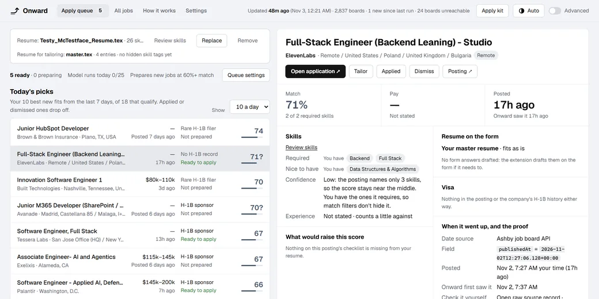
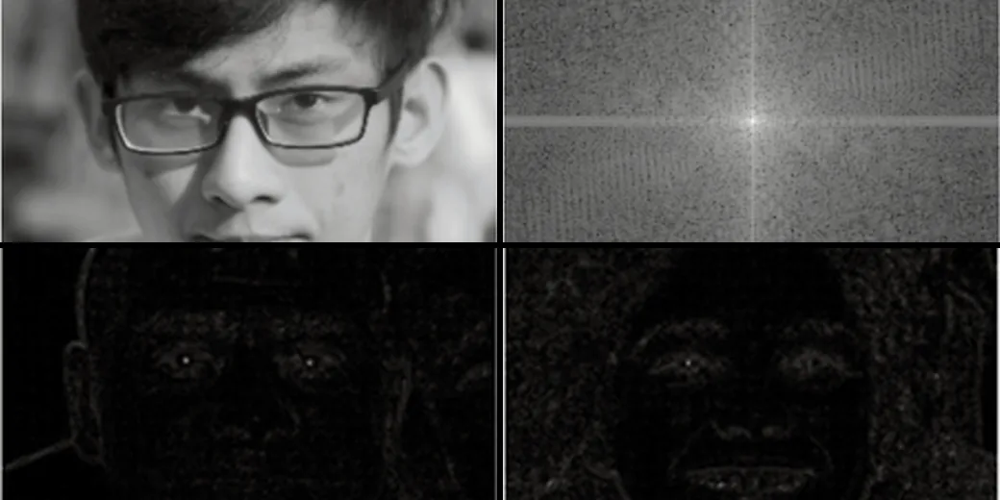
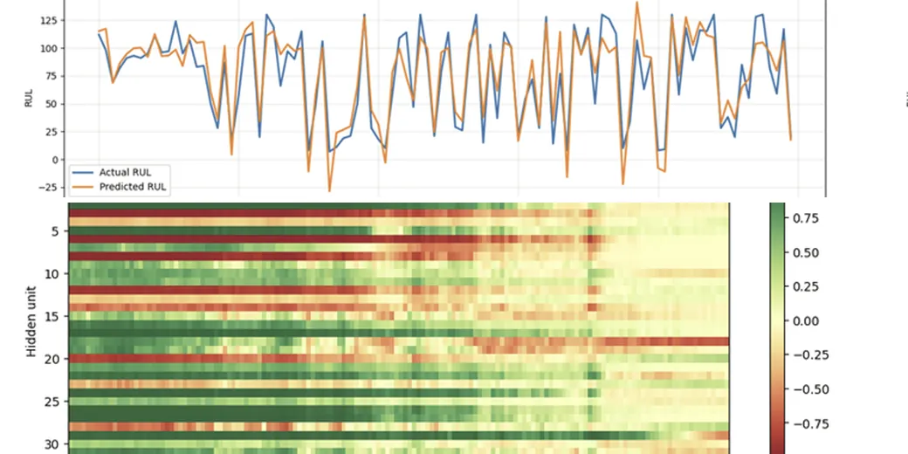
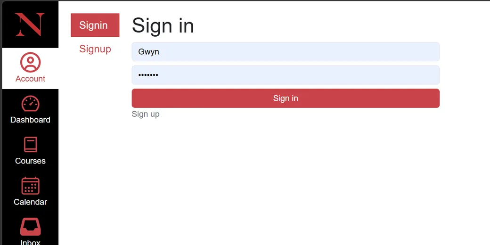

<a href="https://samarthvg.github.io/">
  <picture>
    <source media="(prefers-color-scheme: dark)" srcset="assets/banner-dark.svg">
    
  </picture>
</a>

  <a href="https://samarthvg.github.io/"><picture><source media="(prefers-color-scheme: dark)" srcset="assets/pill-portfolio-dark.svg"></picture></a>&nbsp;
  <a href="https://www.linkedin.com/in/samarthgalchar"><picture><source media="(prefers-color-scheme: dark)" srcset="assets/pill-linkedin-dark.svg"></picture></a>&nbsp;
  <a href="https://samarthvg.github.io/resume.pdf"><picture><source media="(prefers-color-scheme: dark)" srcset="assets/pill-resume-dark.svg"></picture></a>

<picture><source media="(prefers-color-scheme: dark)" srcset="assets/stack-dark.svg"></picture>

<picture><source media="(prefers-color-scheme: dark)" srcset="assets/h-work-dark.svg"></picture>

<table>
  <tr>
    <td width="33%" valign="top">
      <a href="https://github.com/Samarthvg/Onward"><picture><source media="(prefers-color-scheme: dark)" srcset="assets/shots/onward-dark.webp"></picture></a>
       <b><a href="https://github.com/Samarthvg/Onward">Onward</a></b> finds jobs, fills applications
    </td>
    <td width="33%" valign="top">
      <a href="https://farmhouse.samarthg.workers.dev"><picture><source media="(prefers-color-scheme: dark)" srcset="assets/shots/farmhouse-dark.webp"></picture></a>
       <b><a href="https://farmhouse.samarthg.workers.dev">Farm Ledger</a></b> offline farm books, in Hindi
    </td>
    <td width="33%" valign="top">
      <picture><source media="(prefers-color-scheme: dark)" srcset="assets/shots/vision-dark.webp"></picture>
       <b>Deepfake detection</b> 91.3% on 140k faces
    </td>
  </tr>
  <tr>
    <td width="33%" valign="top">
      <a href="https://arxiv.org/abs/2604.27234"><picture><source media="(prefers-color-scheme: dark)" srcset="assets/shots/cmapss-dark.webp"></picture></a>
       <b><a href="https://arxiv.org/abs/2604.27234">Turbofan life</a></b> arXiv paper · LSTM
    </td>
    <td width="33%" valign="top">
      <a href="https://arxiv.org/abs/2412.06703"><picture><source media="(prefers-color-scheme: dark)" srcset="assets/shots/music-dark.webp"></picture></a>
       <b><a href="https://arxiv.org/abs/2412.06703">Music transcription</a></b> arXiv paper · audio ML
    </td>
    <td width="33%" valign="top">
      <a href="https://github.com/Samarthvg/kanbas-react-web-app"><picture><source media="(prefers-color-scheme: dark)" srcset="assets/shots/kanbas-dark.webp"></picture></a>
       <b><a href="https://github.com/Samarthvg/kanbas-react-web-app">Kanbas LMS</a></b> MERN learning platform
    </td>
  </tr>
</table>

<picture><source media="(prefers-color-scheme: dark)" srcset="assets/h-experience-dark.svg"></picture>

<picture><source media="(prefers-color-scheme: dark)" srcset="assets/timeline-dark.svg"></picture>

<picture><source media="(prefers-color-scheme: dark)" srcset="assets/h-activity-dark.svg"></picture>

<picture><source media="(prefers-color-scheme: dark)" srcset="assets/activity-dark.svg"></picture>

<picture><source media="(prefers-color-scheme: dark)" srcset="assets/footer-dark.svg"></picture>
