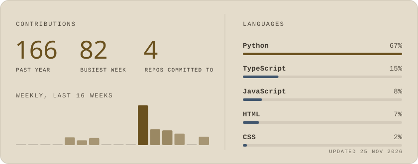

<a href="https://samarthvg.github.io/">
  <picture>
    <source media="(prefers-color-scheme: dark)" srcset="assets/banner-dark.svg">
    
  </picture>
</a>

  <a href="https://samarthvg.github.io/"><picture><source media="(prefers-color-scheme: dark)" srcset="assets/pill-portfolio-dark.svg"></picture></a>&nbsp;
  <a href="https://www.linkedin.com/in/samarthgalchar"><picture><source media="(prefers-color-scheme: dark)" srcset="assets/pill-linkedin-dark.svg"></picture></a>&nbsp;
  <a href="https://samarthvg.github.io/resume.pdf"><picture><source media="(prefers-color-scheme: dark)" srcset="assets/pill-resume-dark.svg"></picture></a>

<picture><source media="(prefers-color-scheme: dark)" srcset="assets/stack-dark.svg"></picture>

<a href="https://www.last.fm/user/Samarthvg"><picture><source media="(prefers-color-scheme: dark)" srcset="https://nowplaying.samarthg.workers.dev/card.svg?theme=dark"></picture></a>

<picture><source media="(prefers-color-scheme: dark)" srcset="assets/timeline-dark.svg"></picture>

<!-- <picture><source media="(prefers-color-scheme: dark)" srcset="assets/h-activity-dark.svg"></picture> -->

<picture><source media="(prefers-color-scheme: dark)" srcset="assets/activity-dark.svg"></picture>

<picture><source media="(prefers-color-scheme: dark)" srcset="assets/footer-dark.svg"></picture>
