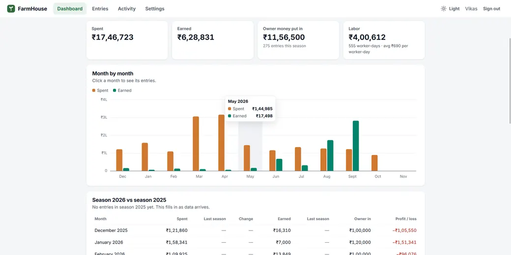
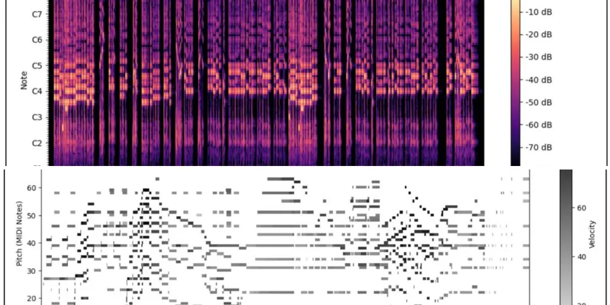

<a href="https://samarthvg.github.io/">
  <picture>
    <source media="(prefers-color-scheme: dark)" srcset="assets/banner-dark.svg">
    
  </picture>
</a>

  <a href="https://samarthvg.github.io/"><picture><source media="(prefers-color-scheme: dark)" srcset="assets/pill-portfolio-dark.svg"></picture></a>&nbsp;
  <a href="https://www.linkedin.com/in/samarthgalchar"><picture><source media="(prefers-color-scheme: dark)" srcset="assets/pill-linkedin-dark.svg"></picture></a>&nbsp;
  <a href="https://samarthvg.github.io/resume.pdf"><picture><source media="(prefers-color-scheme: dark)" srcset="assets/pill-resume-dark.svg"></picture></a>

I'm a software engineer with an M.S. in Computer Science from Northeastern University (2026). I've spent more than a year building full-stack web apps and I also do deep learning research. These days most of my work uses both. I'm looking for full-time roles in software engineering and applied ML.

 

<picture><source media="(prefers-color-scheme: dark)" srcset="assets/h-now-dark.svg"></picture>

**[Onward](https://github.com/Samarthvg/Onward)**: a job hunt that runs on your own computer. Every 30 minutes it checks about 2,300 companies' own hiring systems, scores each posting against your resume skill by skill, and tailors the resume without claiming anything you can't back up. A Firefox extension then fills in the application form. It never presses Submit for you.

**[CramRAG](https://github.com/Samarthvg/CramRAG)**: a study assistant that answers questions and makes flashcards and quizzes from course slides, lecture transcripts and notes. When the slides are thin, it explains instead of just repeating them. A friend and I build it together, and I own the FastAPI and ingestion side.

 

<picture><source media="(prefers-color-scheme: dark)" srcset="assets/h-work-dark.svg"></picture>

<table>
  <tr>
    <td width="50%" valign="top">
      <a href="https://github.com/Samarthvg/Onward"><picture><source media="(prefers-color-scheme: dark)" srcset="assets/shots/onward-dark.webp"></picture></a>
       <b><a href="https://github.com/Samarthvg/Onward">Onward</a></b>&nbsp;&nbsp;DESKTOP APP · MIT
       Finds the job, scores the fit, and fills in the form. You press Submit.
       <code>Python</code> <code>SQLite</code> <code>LaTeX</code> <code>WebExtensions</code>
    </td>
    <td width="50%" valign="top">
      <a href="https://farmhouse.samarthg.workers.dev"><picture><source media="(prefers-color-scheme: dark)" srcset="assets/shots/farmhouse-dark.webp"></picture></a>
       <b><a href="https://farmhouse.samarthg.workers.dev">Farm Ledger</a></b>&nbsp;&nbsp;LIVE · HINDI-FIRST
       A farm's books on a phone, built for older users: one tap per screen, and it works offline.
       <code>React</code> <code>TypeScript</code> <code>Hono</code> <code>Cloudflare D1</code> <code>R2</code>
    </td>
  </tr>
  <tr>
    <td width="50%" valign="top">
      <picture><source media="(prefers-color-scheme: dark)" srcset="assets/shots/vision-dark.webp"></picture>
       <b>Deepfake Detection</b>&nbsp;&nbsp;COMPUTER VISION
       Spots generated faces from frequency-domain features. 91.3% accuracy on a dataset of 140k real and fake faces.
       <code>PyTorch</code> <code>OpenCV</code> <code>C++</code> <code>FFT</code>
    </td>
    <td width="50%" valign="top">
      <a href="https://github.com/Samarthvg/kanbas-react-web-app"><picture><source media="(prefers-color-scheme: dark)" srcset="assets/shots/kanbas-dark.webp"></picture></a>
       <b><a href="https://github.com/Samarthvg/kanbas-react-web-app">Kanbas LMS</a></b>&nbsp;&nbsp;MERN
       A learning platform where the server enforces access control for each role, not just the UI.
       <code>React</code> <code>Node.js</code> <code>Express</code> <code>MongoDB</code> <code>AWS S3</code>
    </td>
  </tr>
</table>

Also: **[AI-thelete](https://github.com/Samarthvg/AIthlete)**, a RAG fitness coach that cites its sources (FastAPI, LangGraph, Pinecone, deployed on GCP), and a **portfolio simulator** in core Java that keeps 100+ portfolios current with live quotes under a strict API rate limit.

 

<picture><source media="(prefers-color-scheme: dark)" srcset="assets/h-research-dark.svg"></picture>

<table>
  <tr>
    <td width="50%" valign="top">
      <a href="https://arxiv.org/abs/2604.27234"><picture><source media="(prefers-color-scheme: dark)" srcset="assets/shots/cmapss-dark.webp"></picture></a>
       <b><a href="https://arxiv.org/abs/2604.27234">Remaining Useful Life Estimation for Turbofan Engines</a></b>
       arXiv:2604.27234
       Compares Ridge, XGBoost, a 1D CNN and an LSTM on NASA C-MAPSS. The LSTM predicts remaining life to within about 14 to 15 cycles.
    </td>
    <td width="50%" valign="top">
      <a href="https://arxiv.org/abs/2412.06703"><picture><source media="(prefers-color-scheme: dark)" srcset="assets/shots/music-dark.webp"></picture></a>
       <b><a href="https://arxiv.org/abs/2412.06703">Source Separation &amp; Automatic Transcription for Music</a></b>
       arXiv:2412.06703
       Detects piano note onsets on the Maestro dataset. A custom focal loss for the class imbalance improved recall by 34%.
    </td>
  </tr>
</table>

 

<picture><source media="(prefers-color-scheme: dark)" srcset="assets/h-experience-dark.svg"></picture>

**Cognitus**: Full Stack Developer Intern \
JUL 2025 – JAN 2026 · DALLAS, TX \
Worked on an internal cost-estimation platform used by 50+ staff. I owned the data model for travel costing and added PouchDB so the app keeps working offline and syncs when it reconnects.

**Simform**: Full Stack Developer \
JUN 2022 – AUG 2023 · GUJARAT, INDIA \
Built client products from the front end to the service layer: React and Angular front ends, plus Node.js and MongoDB microservices on a Scrum team.

**Charotar University**: Machine Learning Research Intern \
APR – SEP 2020 · GUJARAT, INDIA \
Benchmarked Word2Vec against FastText on how well each keeps syntactic and semantic similarity.

 

<picture><source media="(prefers-color-scheme: dark)" srcset="assets/h-toolbox-dark.svg"></picture>

<table>
  <tr><td><b>Languages</b></td><td>Python · TypeScript · JavaScript · Java · C++ · C# · SQL</td></tr>
  <tr><td><b>Frontend</b></td><td>React · Vue · Angular</td></tr>
  <tr><td><b>Backend</b></td><td>Node.js · Express · FastAPI · Hono · REST · microservices</td></tr>
  <tr><td><b>AI / ML</b></td><td>PyTorch · TensorFlow · scikit-learn · LangChain · LangGraph · Hugging Face · OpenCV</td></tr>
  <tr><td><b>Data</b></td><td>PostgreSQL · MongoDB · Redis · SQLite · Pinecone · pandas · NumPy</td></tr>
  <tr><td><b>Cloud</b></td><td>AWS · GCP · Cloudflare Workers · Docker · GitHub Actions</td></tr>
</table>

 

<picture><source media="(prefers-color-scheme: dark)" srcset="assets/h-offclock-dark.svg"></picture>

King Crimson and Nujabes on loop. I'm currently working through Low-Rank Adaptation for Stable Diffusion. I have over 10,000 hours in Dota 2 and no regrets.

<picture><source media="(prefers-color-scheme: dark)" srcset="assets/footer-dark.svg"></picture>
